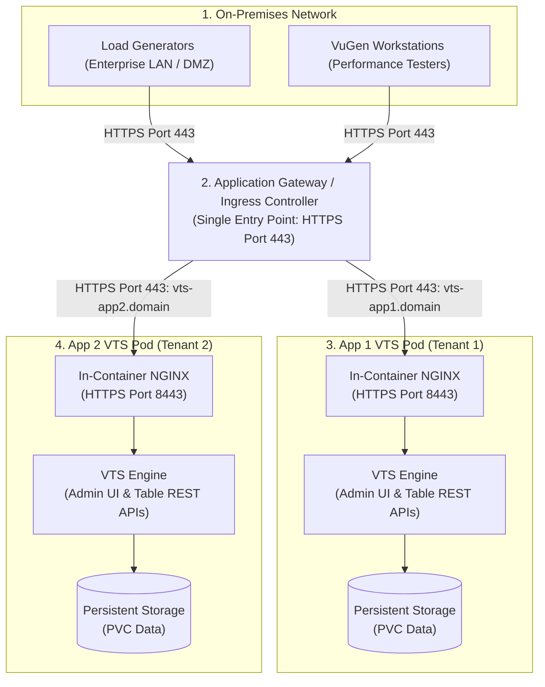

# OpenText Virtual Table Server (VTS) 26.1: Domain-Based Multi-Tenancy Architecture

This repository contains the production-grade Kubernetes/OpenShift deployment specifications for **OpenText Virtual Table Server (VTS) 26.1** running on Linux (Ubuntu Base) utilizing **Domain-Based Multi-Tenancy** (`vts-app1.apps-crc.testing` and `vts-app2.apps-crc.testing`).

> For LoadRunner VuGen script integration, cURL query samples, and test data automation, refer to the dedicated [**vugen_handling_example/TESTERS_GUIDE.md**](vugen_handling_example/TESTERS_GUIDE.md).

---

## 1. Architectural Overview

In **Domain-Based Multi-Tenancy**, each tenant or application team is allocated a dedicated, isolated fully qualified domain name (FQDN):
- **App1 Team:** `https://vts-app1.apps-crc.testing/`
- **App2 Team:** `https://vts-app2.apps-crc.testing/`



---

## 2. Key Architectural Differences: Domain-Based vs. Path-Based

| Architectural Dimension | Path-Based Routing (`/app1-team`) | Domain-Based Routing (`vts-app1...`) |
| :--- | :--- | :--- |
| **Ingress Hostnames** | Single shared host (`vts.apps-crc.testing`) | Dedicated subdomain per team (`vts-app1...`, `vts-app2...`) |
| **URI Path Structure** | Subpath required (`/app1-team`, `/app2-team`) | Clean root path (`/`) |
| **NGINX Complexity** | Requires subpath regex stripping and `sub_filter` HTML/JS modifications | **Pristine native pass-through** (zero HTML/JS rewrites required) |
| **Web UI Experience** | Requires relative path translation for Angular SPA bundles | Native Angular SPA execution at root `/` with zero asset path issues |
| **Tenant Isolation** | Logical (Subpath) + Physical (Separate Pods/PVCs) | Complete Domain DNS Isolation + Physical Pod/PVC Isolation |
| **VuGen Protocol** | Requires `vts_lrvtc.h` to append team subpath prefix | Uses `vts_lrvtc.h` to bridge HTTPS 443 REST directly to target domain |
| **Multi-Instance Support** | Routed via query parameters (`?portnumber=2000`) | Routed via query parameters (`?portnumber=2000`) or `/proxy/:port/` |

---

## 3. In-Container NGINX Reverse Proxy Design

The in-container NGINX reverse proxy (`vts-configmap.yaml` and `vts-app2-configmap.yaml`) runs on port **8443** with TLS enabled:

```nginx
server {
    listen 8443 ssl http2;
    server_name _;

    ssl_certificate      /opt/OT/OT_VTS/web/vts.crt;
    ssl_certificate_key  /opt/OT/OT_VTS/web/vts.key;
    ssl_protocols        TLSv1.2 TLSv1.3;
    ssl_ciphers          HIGH:!aNULL:!MD5;
    ssl_session_cache    shared:SSL:50m;
    ssl_session_timeout  1d;

    # Domain-Based Root Handler (Direct proxy to native VTS on 127.0.0.1:4000)
    location / {
        # 1. Multi-Instance Query-String routing (ports 4000, 8888, 2000-2050)
        if ($query_string ~* "^portnumber=(4000|888[89]|889[0-9]|890[0-8]|20[0-4][0-9]|2050)(.*)$") {
            set $inst_port $1;
            set $inst_param $2;
            proxy_pass http://127.0.0.1:$inst_port$inst_param;
            break;
        }

        # 2. Block SSRF attempts targeting internal Valkey database engines (10000-30000)
        if ($query_string ~* "portnumber=") {
            return 403;
        }

        # 3. Direct proxy to native VTS server (Admin UI, /proxy/:port/ APIs, and WebSockets)
        proxy_pass http://127.0.0.1:4000;
    }
}
```

### Key Capabilities of this Configuration:
1. **Pristine Root Pass-Through:** OpenText VTS Web Admin UI runs without modifying vendor SPA assets.
2. **Transparent API Proxying:** Requests to `/proxy/:port/client_api/*` are handled by OpenText's built-in reverse proxy on port 4000.
3. **SSRF Mitigation:** Query-string port selection is restricted strictly to permitted ports (`4000`, `8888`, `2000`–`2050`). Access attempts to internal Valkey cluster ports (`10000`–`30000`) are blocked immediately with HTTP 403.

---

## 4. Directory & Manifest Manifest

```text
containerized_ubuntu_deployment_domainbasedRoute/
├── README.md                      # This architecture specification
├── deploy_vts_app.sh              # Single-command automated deployer
├── certs/
│   ├── openshift-router-ca.crt    # OpenShift Ingress Root CA for client trust
│   └── vts-backend-ca.crt         # OpenShift Ingress destination CA
├── vts-pvc.yaml                   # 10 GiB RWO storage for App1 Team (vts-app1-data-pvc)
├── vts-configmap.yaml             # configure.json & native NGINX for App1 Team
├── vts-deployment.yaml            # Single-pod workload with auto-symlink for App1
├── vts-service.yaml               # ClusterIP exposing port 443 -> 8443 for App1
├── vts-route.yaml                 # OpenShift Re-encrypt route on vts-app1.apps-crc.testing
├── vts-app2-pvc.yaml              # 10 GiB RWO storage for App2 Team (vts-app2-data-pvc)
├── vts-app2-configmap.yaml        # configure.json & native NGINX for App2 Team
├── vts-app2-deployment.yaml       # Single-pod workload with auto-symlink for App2
├── vts-app2-service.yaml          # ClusterIP exposing port 443 -> 8443 for App2
├── vts-app2-route.yaml            # OpenShift Re-encrypt route on vts-app2.apps-crc.testing
└── vugen_handling_example/
    ├── TESTERS_GUIDE.md           # Step-by-step VuGen and cURL testing guide
    ├── single_script_example.c    # Complete all-in-one single-file VuGen test script
    ├── vuser_init.c               # Modular vuser_init drop-in
    ├── Action.c                   # Modular Action drop-in
    ├── vuser_end.c                # Modular vuser_end drop-in
    └── vts_lrvtc.h                # Drop-in compatibility header for VuGen
```

---

## 5. Automated Deployment & Life-Cycle Management

### Deploy Both Teams:
```bash
cd /home/mahesh/vts_ocp/containerized_ubuntu_deployment_domainbasedRoute
./deploy_vts_app.sh all
```

### Deploy Individual Team:
```bash
./deploy_vts_app.sh app1
# or
./deploy_vts_app.sh app2
```

---

## 6. Data Durability, Self-Healing, and Persistence

1. **Persistent Volume Claim (`vts-*-data-pvc`):**
   - Retains Valkey RDB snapshot files and `instances.json` across container restarts.
2. **Pre-Stop Flush Hook:**
   - On pod termination, Kubernetes executes a `preStop` hook that executes `valkey-cli save` against all running Valkey instances to guarantee zero data loss.
3. **Auto-Discovery & Repair (`instances.json`):**
   - At pod startup, an inline Node.js routine strips binary nulls (`\0`), restores from `.bak` if corrupted, and automatically scans existing `.vts` databases in the PVC to re-register instances seamlessly.

---

## 7. Security & Compliance Architecture

1. **Non-Root Execution:** Workload runs under non-root UID `54345` (`vts_user`) with `fsGroup: 54345`.
2. **End-to-End TLS Encryption:**
   - External clients connect via HTTPS (Port 443) to OpenShift Ingress Router.
   - OpenShift Ingress Router connects via TLS 1.2/1.3 (Port 8443) using destination CA certificate [`vts-backend-ca.crt`](certs/vts-backend-ca.crt).
3. **Role-Based Access Control (RBAC):**
   - API endpoints enforce HTTP Basic Authentication (`Authorization: Basic ...`) with administrator and user roles configured in `configure.json`.
4. **SSRF Mitigation:** Query-string port redirection is restricted strictly to permitted ports (`4000`, `8888`, `2000–2050`). Access to internal Valkey ports (`10000–30000`) is blocked with HTTP 403.

---

## 8. Enterprise Architectural Defense: Why `vts_lrvtc.h` is Mandatory

When presenting this architecture to performance testing teams, enterprise architects, and cyber security leads, use the following technical defense:

### A. The Ingress Reality: Dual-Port Raw TCP vs. Single HTTPS Port 443
* **Legacy Windows VM VTS:** In legacy on-premises environments, each VTS table instance opened an independent, unencrypted, raw TCP port (`8888`, `2000`, `2001` up to `2050`). LoadRunner's native `vtc.dll` connected directly to these raw sockets.
* **Enterprise Cloud Kubernetes / OpenShift:** Enterprise security standards and cloud Ingress controllers strictly forbid exposing arbitrary raw TCP ports. All inbound traffic **must enter exclusively via standard HTTPS Port 443** with TLS inspection. Native `vtc.dll` has no capability to route multi-instance traffic over a single Layer 7 HTTPS port.

### B. The Protocol Disconnect: Modern Go REST API vs. Legacy Binary Sockets
* **OpenText VTS 26.1 Backend:** OpenText completely re-architected the Linux VTS backend in Go (Gin framework), exposing modern RESTful HTTP endpoints (`/client_api/queryRow`, `/client_api/update`, `/client_api/getTable`).
* **LoadRunner `vtc.dll` Client Driver:** The built-in client DLL inside VuGen 2026.1 still transmits legacy 2012 C/C++ binary socket RPC frames. When connecting to containerized VTS, `vtc.dll` fails during session negotiation (`Cannot parse server response` / `Failed to connect to the server`).
* **The Bridge (`vts_lrvtc.h`):** The header intercepts standard `lrvtc_*` method calls and executes them via LoadRunner’s native Web Turbo Replay engine (`web_custom_request`) over HTTPS port 443. All test logic in `Action.c` remains **100% standard LoadRunner C code**.

### C. Enterprise Cloud Portability (Local CRC to Production Cloud)
The compatibility header is **100% environment-agnostic**:
* It contains zero hardcoded IP addresses or cluster paths.
* **Moving from local CRC to the Enterprise Cloud Landing Zone requires ZERO code changes in the header.**
* Only the domain name string in `lrvtc_connect()` changes (e.g. from `vts-app1.apps-crc.testing` to `vts-app1.<enterprise-cloud-domain>`).
* On-premises physical Load Generators, cloud Load Generators, and tester workstations interact identically over outbound HTTPS port 443.

### D. Why OpenText Documented Docker Daemon but Not Kubernetes
* OpenText’s documentation illustrates a basic standalone Docker host where all ports (`4000`, `8888`, `2000–2050`) are bound directly to host network interfaces (`--net=host`). This assumes a flat, non-production network without firewalls, Ingress controllers, or tenant isolation.
* Enterprise Kubernetes / OpenShift platforms require declarative Ingress routing (Port 443 only), pod auto-recovery, persistent storage decoupling (PVCs), and non-root security contexts.
* OpenText delivered the application container image; enterprise Ingress orchestration and client protocol bridging are standard enterprise enablement responsibilities.

---

## 9. Stakeholder FAQ & Architectural Defense Playbook

| Stakeholder | Potential Concern / Question | Authoritative Architectural Defense |
| :--- | :--- | :--- |
| **Performance Testers** | *"Do we need to rewrite all our existing VTS test scripts?"* | **No.** Your `Action.c` code remains 100% standard (`lrvtc_query_row`, `lrvtc_update_message`, `lr_eval_string`). You simply include `vts_lrvtc.h` in `vuser_init.c` to route over HTTPS port 443. |
| **Cyber Security & Networks** | *"Why can't VuGen connect directly on port 8888 or 2000?"* | Exposing 50+ raw unencrypted TCP ports through enterprise cloud firewalls violates Zero-Trust policies. Our solution routes 100% of VTS traffic through standard HTTPS Port 443 with TLS 1.2/1.3 re-encryption. |
| **Cloud Platform Architects** | *"Why didn't OpenText provide native Ingress support out of the box?"* | OpenText's documentation only covers standalone Docker daemon on single VMs. In Kubernetes platforms, Layer 7 Ingress routing on Port 443 is mandatory. The header bridges OpenText's legacy client DLL to their modern Go REST API. |
| **Project & Test Leads** | *"Will this setup break or require major rework in production cloud?"* | **No.** The header and manifests are cloud-agnostic. The exact same header and container configuration will deploy seamlessly to production enterprise OpenShift or Kubernetes. |
