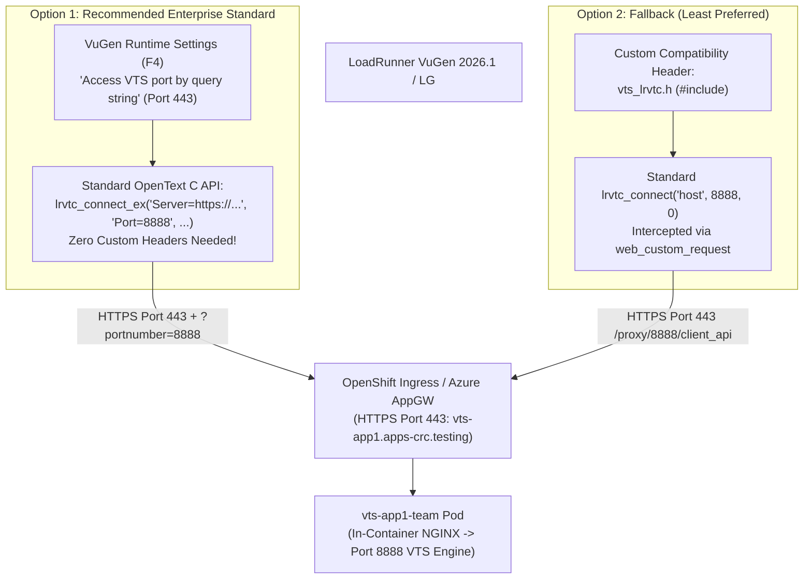

# OpenText Virtual Table Server (VTS) 26.1: Domain-Based VuGen Tester Guide

This guide is designed for **Performance Test Engineers**, **VuGen Scripters**, and **QA Automation Teams** interacting with containerized OpenText Virtual Table Server (VTS) 26.1 deployed on Red Hat OpenShift / CRC using **Domain-Based Multi-Tenancy**:
- **App1 Team:** `https://vts-app1.apps-crc.testing/`
- **App2 Team:** `https://vts-app2.apps-crc.testing/`

---

## 1. What This Folder Contains

| File | Type | Description |
| :--- | :--- | :--- |
| [`single_script_option1_native_connect_ex.c`](file:///home/mahesh/vts_ocp/containerized_ubuntu_deployment_domainbasedRoute/vugen_handling_example/single_script_option1_native_connect_ex.c) | C Source | **OPTION 1 (RECOMMENDED / ENTERPRISE STANDARD):** Complete single-file LoadRunner script using 100% native OpenText `lrvtc_connect_ex` with Runtime Settings Query String. ZERO custom wrappers required! |
| [`single_script_option2_wrapper_header.c`](file:///home/mahesh/vts_ocp/containerized_ubuntu_deployment_domainbasedRoute/vugen_handling_example/single_script_option2_wrapper_header.c) | C Source | **OPTION 2 (FALLBACK / LEAST PREFERRED):** Complete single-file LoadRunner script using the custom wrapper header `vts_lrvtc.h` for legacy VuGen versions. |
| [`vuser_init.c`](file:///home/mahesh/vts_ocp/containerized_ubuntu_deployment_domainbasedRoute/vugen_handling_example/vuser_init.c) | C Source | Modular `vuser_init` showcasing Option 1 as active, with Option 2 commented. |
| [`Action.c`](file:///home/mahesh/vts_ocp/containerized_ubuntu_deployment_domainbasedRoute/vugen_handling_example/Action.c) | C Source | Modular `Action` showing `lrvtc_query_row` and `lrvtc_update_message` transactions. |
| [`vuser_end.c`](file:///home/mahesh/vts_ocp/containerized_ubuntu_deployment_domainbasedRoute/vugen_handling_example/vuser_end.c) | C Source | Modular `vuser_end` for clean `lrvtc_disconnect`. |
| [`vts_lrvtc.h`](file:///home/mahesh/vts_ocp/containerized_ubuntu_deployment_domainbasedRoute/vugen_handling_example/vts_lrvtc.h) | C Header | Custom compatibility wrapper header (Used only for Option 2). |
| [`TESTERS_GUIDE.md`](file:///home/mahesh/vts_ocp/containerized_ubuntu_deployment_domainbasedRoute/vugen_handling_example/TESTERS_GUIDE.md) | Markdown | This step-by-step setup, configuration, and execution manual. |

---

## 2. Two Implementation Approaches in Domain-Based Routing

In Domain-Based Multi-Tenancy, two options are available for VuGen script integration:



---

## 3. Option 1: Native OpenText `lrvtc_connect_ex` (Recommended Enterprise Standard)

This is the **primary recommended standard** because it uses 100% native vendor functionality documented in the OpenText LoadRunner Help Center, requiring **zero custom wrapper headers or maintenance overhead**.

### Step 1: Configure VuGen Runtime Settings (`F4`)
1. In VuGen, press **`F4`** (or go to **Replay** -> **Runtime Settings**).
2. In the left panel, navigate to **General** -> **Miscellaneous**.
3. Under the **VTS** section:
   - Check the box: **"Access VTS port by query string"**.
   - Ensure the HTTPS Port is set to: **`443`**.
4. Click **Save** / **OK**.

### Step 2: Write Native C Code
In the script (`vuser_init.c` or [`single_script_option1_native_connect_ex.c`](file:///home/mahesh/vts_ocp/containerized_ubuntu_deployment_domainbasedRoute/vugen_handling_example/single_script_option1_native_connect_ex.c)):

```c
#include "lrun.h"
#include "web_api.h"

int vuser_init()
{
    int rc;

    lr_output_message("[VTS] Connecting natively via lrvtc_connect_ex to port 8888...");

    // Native extended connect passing credentials and TLS 443 routing
    rc = lrvtc_connect_ex(
        "Server=https://vts-app1.apps-crc.testing",
        "Port=8888",
        "UserName=vtsadmin",
        "Password=*****",
        LAST);

    lr_output_message(">>> Native lrvtc_connect_ex return code: %d", rc);

    if (rc != 0) {
        lr_error_message(">>> [FATAL] Failed to connect to VTS! Return code: %d", rc);
        return -1;
    }

    lr_output_message(">>> [SUCCESS] Connected cleanly to VTS via native lrvtc_connect_ex!");
    return 0;
}
```

> [!IMPORTANT]
> The `Server=` argument **MUST** begin with `https://`. According to OpenText documentation, `Server=` defaults to plain `http://` if the protocol prefix is omitted, which causes an unencrypted handshake against port 443 that fails with `Cannot parse server response`.

### Step 3: Multi-Instance Table Switching (Port 8888 vs Port 2001)
To access different isolated tables within the same pod, simply alter the `Port=` argument:
- **Default Table:** `"Port=8888"`
- **Secondary Multi-Instance Table (e.g. Instance_1):** `"Port=2001"`
- **App 2 Team:** Change server to `"Server=https://vts-app2.apps-crc.testing"` and port to `"Port=8888"`

### Step 4: Replay Verification Log
When replaying Option 1 in VuGen 2026.1, the output log confirms native execution with sub-200ms transaction times:

```text
Virtual User Script started at: 11/19/2026 6:56:27 PM
Starting action vuser_init.
vuser_init.c(15): [VTS] Testing native OpenText lrvtc_connect_ex...
vuser_init.c(24): >>> Native lrvtc_connect_ex return code: 0
Ending action vuser_init.
Running Vuser...
Starting iteration 1.
Starting action Action.
Action.c(5): Notify: Transaction "VTS_01_Query_Customer_Data" started.
Action.c(10): >>> [ROW 1] Customer Code : IND_Cust_1
Action.c(11): >>> [ROW 1] Account Num   : IND_ACC_10001
Action.c(12): >>> [ROW 1] Current Status: PROCESSED_VIA_LRVTC_CONNECT_EX
Action.c(14): Notify: Transaction "VTS_01_Query_Customer_Data" ended with a "Pass" status (Duration: 0.1886 Wasted Time: 0.1130).
Action.c(17): Notify: Transaction "VTS_02_Update_Status" started.
Action.c(22): >>> [ROW 1] Updated Status to 'PROCESSED_VIA_LRVTC_CONNECT_EX'
Action.c(24): Notify: Transaction "VTS_02_Update_Status" ended with a "Pass" status (Duration: 0.1574 Wasted Time: 0.1135).
Ending action Action.
Ending iteration 1.
Ending Vuser...
Starting action vuser_end.
vuser_end.c(4): >>> [VTS] Session disconnected cleanly.
Ending action vuser_end.
Vuser Terminated.
```

---

## 4. Option 2: Custom Header File (`vts_lrvtc.h`) (Least Preferred / Fallback)

This fallback option is provided strictly for **legacy LoadRunner versions** that lack `lrvtc_connect_ex` or environments where test operators cannot modify VuGen Runtime Settings.

### How Option 2 Works:
1. Copy [`vts_lrvtc.h`](file:///home/mahesh/vts_ocp/containerized_ubuntu_deployment_domainbasedRoute/vugen_handling_example/vts_lrvtc.h) into the VuGen script folder.
2. In `globals.h` or `vuser_init.c`, include the header:
   ```c
   #include "vts_lrvtc.h"
   ```
3. Call standard `lrvtc_connect`:
   ```c
   int rc = lrvtc_connect("vts-app1.apps-crc.testing", 8888, 0);
   ```
4. The macro intercepts `lrvtc_*` calls and routes them through LoadRunner's Web Turbo Replay engine (`web_custom_request`) over HTTPS 443.

See [`single_script_option2_wrapper_header.c`](file:///home/mahesh/vts_ocp/containerized_ubuntu_deployment_domainbasedRoute/vugen_handling_example/single_script_option2_wrapper_header.c) for the complete runnable example.

---

## 5. Architectural Comparison Matrix

| Capability / Metric | Option 1: Native `lrvtc_connect_ex` (Recommended) | Option 2: Wrapper Header `vts_lrvtc.h` (Fallback) |
| :--- | :--- | :--- |
| **VuGen C API** | Standard OpenText Vendor API (`lrvtc_connect_ex`) | Preprocessor Macros overriding `lrvtc_*` |
| **Custom Files in Script** | **Zero** (None required) | Requires `vts_lrvtc.h` in script directory |
| **Runtime Settings** | Requires "Access VTS port by query string" (F4) | Default settings (No changes needed) |
| **Port Routing Mechanism** | Dynamic query string (`?portnumber=8888`) | Internal reverse proxy (`/proxy/:port/client_api`) |
| **LoadRunner Compatibility** | VuGen 2020 SP2, 2023, 2026.1+ | All LoadRunner versions (11.52 to 2026.1) |
| **Enterprise Maintenance** | **Minimal** (Standard OpenText documentation) | Requires maintaining `vts_lrvtc.h` header |

---

## 6. One-Time Client Setup (Windows Testing Machine)

### Step 1: Configure Hosts File
Ensure the testing workstation resolves the team domains:
* **On Windows (`C:\Windows\System32\drivers\etc\hosts` as Administrator):**
  ```text
  127.0.0.1 vts-app1.apps-crc.testing vts-app2.apps-crc.testing
  ```
*(Replace `127.0.0.1` with the actual OpenShift Ingress Router IP in distributed environments).*

### Step 2: Verify in Web Browser
Open Microsoft Edge or Chrome and verify connectivity:
- `https://vts-app1.apps-crc.testing/`
- `https://vts-app2.apps-crc.testing/`
- Credentials: `vtsadmin` / `*****`
- Verify that table columns (`Customer_Code`, `Account_Num`, `Status`) load cleanly.
