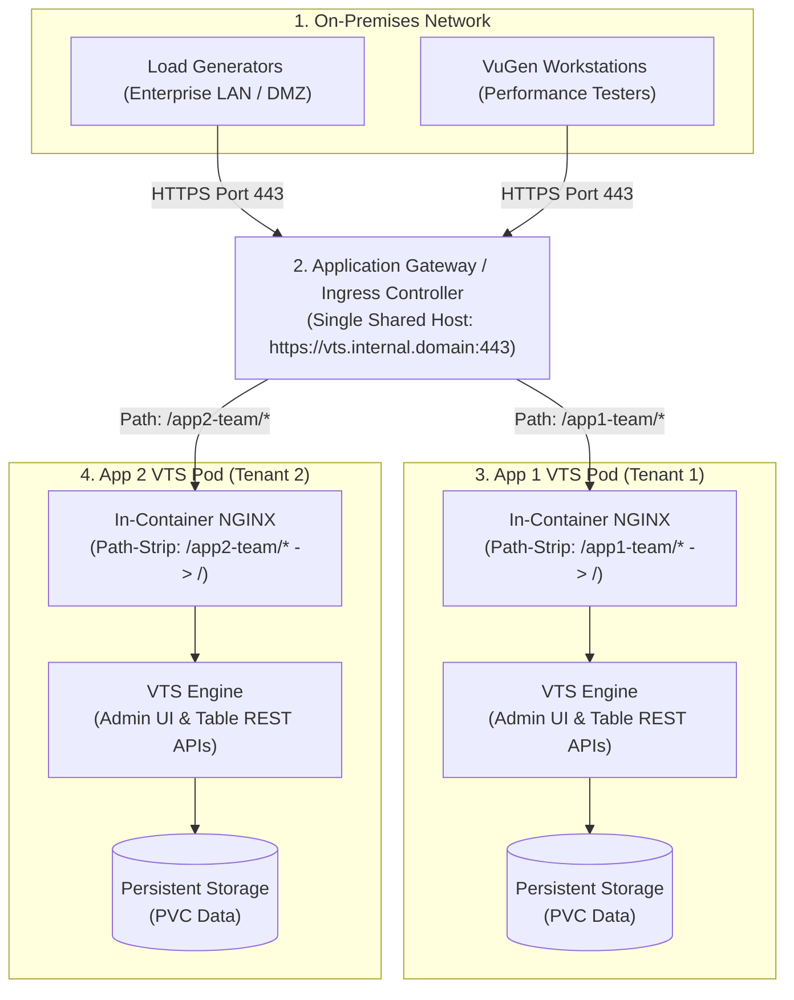

# OpenText Virtual Table Server (VTS) 26.1: Platform Deployment & Infrastructure Specification

This document provides complete technical specifications, infrastructure designs, container runtime details, and deployment procedures for deploying containerized **OpenText Virtual Table Server (VTS) 26.1** on **Red Hat OpenShift / CRC** using **Path-Based Multi-Tenancy**.

> [!NOTE]
> For LoadRunner VuGen script integration, cURL query samples, and test data automation, refer to the dedicated [**TESTERS_GUIDE.md**](vugen_handling_example/TESTERS_GUIDE.md).

---

## Table of Contents

1. [Architectural Overview](#1-architectural-overview)
2. [Container OS, User & Permission Model](#2-container-os-user--permission-model)
   - [Base Image & OS Environment](#21-base-image--os-environment)
   - [User & Group Matrix (vts_user & NGINX)](#22-user--group-matrix-vts_user--nginx)
   - [OpenShift Security Context Constraints (SCC) & fsGroup](#23-openshift-security-context-constraints-scc--fsgroup)
3. [Filesystem Layout, Mounts & Permissions](#3-filesystem-layout-mounts--permissions)
   - [Binary & Application Root Paths](#31-binary--application-root-paths)
   - [ConfigMap SubPath Volume Mounts](#32-configmap-subpath-volume-mounts)
   - [Persistent Storage (PVC) & Data Directory](#33-persistent-storage-pvc--data-directory)
   - [Non-Destructive Symlink Architecture for instances.json](#34-non-destructive-symlink-architecture-for-instancesjson)
4. [Process Architecture & Supervisor Daemon](#4-process-architecture--supervisor-daemon)
   - [Process Tree & Execution Flow](#41-process-tree--execution-flow)
   - [Supervisor Daemon (api_daemon)](#42-supervisor-daemon-api_daemon)
   - [Internal Database Engine (Valkey)](#43-internal-database-engine-valkey)
   - [Graceful Shutdown (preStop Lifecycle Hook)](#44-graceful-shutdown-prestop-lifecycle-hook)
5. [Network, Ingress & Port Matrix](#5-network-ingress--port-matrix)
   - [Port Allocation Architecture](#51-port-allocation-architecture)
   - [In-Container NGINX Reverse Proxy (Port 8443)](#52-in-container-nginx-reverse-proxy-port-8443)
   - [In-Flight Stream Transformations (sub_filter)](#53-in-flight-stream-transformations-sub_filter)
   - [Gorilla WebSocket Upgrade & Connection Header Handling](#54-gorilla-websocket-upgrade--connection-header-handling)
   - [SSRF Mitigation & Port Guardrails](#55-ssrf-mitigation--port-guardrails)
6. [Multi-Tenant Deployment & Scale Validation](#6-multi-tenant-deployment--scale-validation)
   - [Dual-Pod Tenant Isolation (app1-team & app2-team)](#61-dual-pod-tenant-isolation-app1-team--app2-team)
   - [20 Active Instances & 100k Records per Team](#62-20-active-instances--100k-records-per-team)
   - [Cold Pod Recreate & Crash Recovery Verification](#63-cold-pod-recreate--crash-recovery-verification)
7. [Deployment Playbook & Manifest Reference](#7-deployment-playbook--manifest-reference)
   - [Manifest Inventory](#71-manifest-inventory)
   - [Automated Deployment (deploy_vts_app.sh)](#72-automated-deployment-deploy_vts_appsh)
   - [Infrastructure Verification Commands](#73-infrastructure-verification-commands)

---

## 1. Architectural Overview

The deployment enables dual-tenant hosting on OpenShift under a single shared Fully Qualified Domain Name (`https://vts.apps-crc.testing`) with zero modifications to vendor files on disk:



---

## 2. Container OS, User & Permission Model

### 2.1 Base Image & OS Environment
* **Container Image:** `performancetesting/opentext_vts_linux_ubuntu:26.1`
* **Underlying OS:** Ubuntu 22.04 LTS (Jammy Jellyfish) x86_64
* **C Run-time & Libraries:** Glibc 2.35, OpenSSL 3.0.2

### 2.2 User & Group Matrix (vts_user & NGINX)
OpenShift enforces strict unprivileged user policies (Restricted SCC). The container is engineered to run without root privileges:

| User / Group | UID / GID | Component | Purpose | Permissions |
| :--- | :--- | :--- | :--- | :--- |
| **`vts_user`** | `54345` / `54345` | VTS Binaries (`apiserver`, `api_daemon`, `valkey-server`) | Runs internal VTS application processes | Owner of `/opt/OT/OT_VTS/web` and `/var/lib/OT/OT_VTS/db/data` |
| **`nginx`** | Runs as current pod UID (`54345` / Arbitrary) | In-Container NGINX | Listens on port `8443`, writes PID to `/tmp/nginx.pid` and logs to `/tmp/nginx_error.log` | Unprivileged non-root execution |
| **`root`** | `0` / `0` | Base OS (Build-time only) | Installed system packages during image creation | Zero runtime root privileges required |

### 2.3 OpenShift Security Context Constraints (SCC) & fsGroup
To ensure persistent storage volumes attached via OpenShift CSI drivers are writable by `vts_user`, the Deployment specifies:

```yaml
spec:
  template:
    spec:
      securityContext:
        fsGroup: 54345 # Matches vts_user group ID
```
When OpenShift mounts the PersistentVolumeClaim at `/var/lib/OT/OT_VTS/db/data`, it recursively chowns the volume mount to GID `54345`, ensuring seamless read/write access for Valkey databases and `instances.json`.

---

## 3. Filesystem Layout, Mounts & Permissions

### 3.1 Binary & Application Root Paths

```
/opt/OT/OT_VTS/
|-- bin/
|   |-- vts_export.sh           # CLI database export utility
|   `-- vts_import.sh           # CLI database import utility
|-- samples/                    # Default sample CSVs
`-- web/                        # Working Directory (/opt/OT/OT_VTS/web)
    |-- api_daemon              # VTS supervisor daemon (ELF 64-bit LSB executable)
    |-- apiserver               # Main VTS REST/Go web server (Gin framework)
    |-- cmdHandler              # Command execution handler
    |-- configure.json          # Mounted from ConfigMap (RBAC & port configuration)
    |-- dist/browser/           # Angular SPA compiled static assets
    |-- instances.json          # Symlink -> /var/lib/OT/OT_VTS/db/data/instances.json
    |-- node                    # Standalone Node.js v20.x binary runtime
    |-- redis.conf              # Valkey configuration template (RDB snapshot rules)
    |-- valkey-server           # Valkey in-memory storage engine
    |-- valkey-cli              # Valkey command-line tool
    |-- vts.crt                 # In-container SSL certificate
    `-- vts.key                 # In-container SSL private key
```

### 3.2 ConfigMap SubPath Volume Mounts
To maintain the official vendor image 100% pristine, configuration files are injected via Kubernetes `subPath` mounts:

1. **VTS Core Configuration (`configure.json`):**
   - Source: ConfigMap `vts-app1-config` (key: `configure.json`)
   - Target: `/opt/OT/OT_VTS/web/configure.json`
   - Content: VTS 26.1 RBAC definitions (`vtsadmin:*****`), Valkey port range (`10000–30000`), connection pool settings.
2. **NGINX Reverse Proxy Configuration (`vts-nginx.conf`):**
   - Source: ConfigMap `vts-app1-config` (key: `vts-nginx.conf`)
   - Target: `/etc/nginx/nginx.conf`
   - Content: TLS 1.2/1.3 reverse-proxy on port `8443`, path-stripping rules, Angular stream rewrite filters.

### 3.3 Persistent Storage (PVC) & Data Directory
- **Mount Path:** `/var/lib/OT/OT_VTS/db/data`
- **Volume Claim:** `vts-app1-data-pvc` (10 GiB RWO, ReadWriteOnce)
- **Persisted Assets:**
  - `instances.json` (metadata of all configured instances and ports)
  - `instances.json.bak` (automatic backup created during boot and shutdown)
  - `Default.vts`, `Instance_1.vts`, ..., `Instance_19.vts` (Valkey RDB dump files)

### 3.4 Non-Destructive Symlink Architecture for `instances.json`
VTS hardcodes instance metadata reading and writing to `/opt/OT/OT_VTS/web/instances.json`. Because `/opt/OT/OT_VTS/web` is container-ephemeral, container recreations would lose all instance configurations.

The deployment entrypoint resolves this with automated self-healing symlink bootstrapping:
```bash
# 1. Verify persistent storage directory exists
mkdir -p /var/lib/OT/OT_VTS/db/data

# 2. Inspect persistent instances.json via embedded Node runtime:
#    - Strips binary null bytes (\0) if corrupted by an unclean kernel kill
#    - Restores from instances.json.bak if unreadable
#    - Auto-discovers existing *.vts database files to re-register lost instances
#    - Seeds Default instance (port 8888) only on a fresh empty volume
/opt/OT/OT_VTS/web/node -e '<repair_and_validation_script>' ...

# 3. Create atomic symlink from container path to persistent storage
ln -sf /var/lib/OT/OT_VTS/db/data/instances.json /opt/OT/OT_VTS/web/instances.json
```

---

## 4. Process Architecture & Supervisor Daemon

### 4.1 Process Tree & Execution Flow
Inside the running pod, processes operate in a strictly coordinated tree:

```
[PID 1] /bin/bash (Entrypoint script)
  |-- [PID 13-19] nginx: master & worker processes (Listening on 0.0.0.0:8443)
  |-- [PID 24]    ./api_daemon (VTS Supervisor)
  |     |-- [PID 25]  ./apiserver (Listens on 4000, 8888, 2000-2018)
  |     |-- [PID 31]  ./valkey-server 127.0.0.1:14937 (Default Table DB)
  |     |-- [PID 42]  ./valkey-server 127.0.0.1:27980 (Instance_1 DB)
  |     `-- [PID ...] ./valkey-server 127.0.0.1:XXXXX (Instances 2-19 DBs)
  `-- wait -n (Keeps container alive; terminates if any critical process dies)
```

### 4.2 Supervisor Daemon (`api_daemon`)
* `api_daemon` is OpenText's internal process manager.
* It monitors `apiserver` and automatically spawns individual `valkey-server` instances whenever a table instance is enabled.
* If a Valkey instance crashes, `api_daemon` detects the exit and restarts the process against its persisted `.vts` data file.

### 4.3 Internal Database Engine (Valkey)
* OpenText VTS 26.1 replaced legacy SQLite/internal engines with **Valkey** (a high-performance, Redis-compatible in-memory key-value data store).
* Tables are stored in memory for microsecond query latency, with background asynchronous snapshots (`BGSAVE`) configured via `redis.conf`:
  ```
  save 60 1  # Save to disk every 60 seconds if at least 1 key changed
  ```

### 4.4 Graceful Shutdown (`preStop` Lifecycle Hook)
When Kubernetes terminates a pod (e.g., node drain, rollout, or scaling), it issues a `SIGTERM` followed by `SIGKILL` after `terminationGracePeriodSeconds` (default: 30s).

To prevent data corruption, a `preStop` container lifecycle hook executes synchronously before termination:
1. Copies `/var/lib/OT/OT_VTS/db/data/instances.json` to `.bak`.
2. Iterates across all active `valkey-server` PIDs, identifies their local loopback ports, and sends an explicit `/opt/OT/OT_VTS/web/valkey-cli -p <PORT> save` command to flush all in-memory tables directly to persistent disk.
3. Issues `sync` to guarantee filesystem buffer flushing to underlying block storage.

---

## 5. Network, Ingress & Port Matrix

### 5.1 Port Allocation Architecture

| Layer | Port | Protocol | Scope | Purpose |
| :--- | :--- | :--- | :--- | :--- |
| **Ingress Router** | `443` | HTTPS (TLS 1.2/1.3) | Public / LG Facing | External endpoint on `vts.apps-crc.testing` |
| **Kubernetes Service** | `443` $\rightarrow$ `8443` | TCP (ClusterIP) | Cluster-Internal | Internal service proxying to pod NGINX |
| **In-Container NGINX** | `8443` | HTTPS (HTTP/1.1 - TLS 1.2/1.3) | Pod-Internal | SSL termination, path stripping, and SPA stream rewriting |
| **VTS Admin Web UI** | `4000` | HTTP / WebSocket | `127.0.0.1` | Management console and Gorilla WebSocket endpoint (`/ws`) |
| **Default Table API** | `8888` | HTTP | `127.0.0.1` | Data query/update API for Default instance |
| **Custom Tables** | `2000`–`2018` | HTTP | `127.0.0.1` | Data query/update APIs for custom instances 1 through 19 |
| **Valkey Storage Engines**| `10000`–`30000` | Valkey Protocol | `127.0.0.1` | Internal DB engines (blocked from external ingress via NGINX) |

### 5.2 In-Container NGINX Reverse Proxy (Port 8443)
OpenShift Routes use **Re-encrypt** TLS termination:
- Outer leg: Clients connect to OpenShift Router over HTTPS on port 443.
- Inner leg: OpenShift Router re-encrypts traffic to the backend Pod over HTTPS on port `8443`, validating the pod's certificate against the destination CA certificate (`certs/vts-backend-ca.crt`).

### 5.3 In-Flight Stream Transformations (`sub_filter`)
The NGINX configuration strips the team subpath and dynamically patches the compiled Angular Single Page Application (SPA) in real time:

```nginx
location ~ ^/(?<team_prefix>app[0-9]+-team)(?<req_path>/.*)?$ {
    # 1. Multi-Instance Query-String routing (ports 4000, 8888, 2000-2050)
    if ($query_string ~* "^portnumber=(4000|888[89]|889[0-9]|890[0-8]|20[0-4][0-9]|2050)(.*)$") {
        set $inst_port $1;
        set $inst_param $2;
        proxy_pass http://127.0.0.1:$inst_port$inst_param;
        break;
    }

    # 2. Strip team prefix and proxy to VTS native server
    rewrite ^/[^/]+(/.*)?$ $1 break;
    proxy_pass http://127.0.0.1:4000;

    # 3. Stream filters patching vendor Angular SPA
    sub_filter '<base href="/">' '<base href="/$team_prefix/">';
    sub_filter 'this.baseURL=""' 'this.baseURL="/$team_prefix"';
    sub_filter 'prefix:"/assets/i18n/"' 'prefix:"assets/i18n/"';
    sub_filter '}/ws`' '}/$team_prefix/ws`';
    sub_filter 'window.open(o,"_blank")' 'window.open(o.slice(1),"_blank")';
    sub_filter 'window.open(s,"_blank")' 'window.open(s.slice(1),"_blank")';
    sub_filter_types application/javascript text/javascript;
    sub_filter_once off;
}
```

### 5.4 Gorilla WebSocket Upgrade & Connection Header Handling
When using `sub_filter`, NGINX disables gzip with `proxy_set_header Accept-Encoding "";`. 
In NGINX, declaring `proxy_set_header` in a location block wipes out all inherited headers from parent blocks.

To prevent the Gorilla WebSocket on port 4000 from failing with `400 Bad Request` (UI showing `Disconnected`), the upgrade headers are explicitly declared directly inside the location block:
```nginx
proxy_set_header Upgrade $http_upgrade;
proxy_set_header Connection $connection_upgrade;
```

### 5.5 SSRF Mitigation & Port Guardrails
Direct external access to internal Valkey database engine ports (`10000–30000`) is strictly blocked by NGINX:
```nginx
if ($query_string ~* "portnumber=") {
    return 403;
}
```
Only authorized application ports (`4000`, `8888`, and `2000–2050`) are forwarded.

### 5.6 HTTP/2 Vulnerability Remediation (CVE-2026-123007 & CVE-2026-123633)
To permanently eliminate critical NGINX memory-safety vulnerabilities in the HTTP/2 module (`ngx_http_v2_module`):
- HTTP/2 is explicitly disabled on the NGINX socket (`listen 8443 ssl;`).
- This completely deactivates the HTTP/2 processing engine, neutralizing both unauthenticated Heap Buffer Overflow (CVE-2026-123007) and Use-After-Free (CVE-2026-123633) with zero impact to OpenShift Ingress or VTS communication (which operate on standard HTTP/1.1).

---

## 6. Multi-Tenant Deployment & Scale Validation

### 6.1 Dual-Pod Tenant Isolation (`app1-team` & `app2-team`)
The namespace `lre-vts` hosts two independent single-pod stateful workloads:
- **`vts-app1-team`:** Accessible at `https://vts.apps-crc.testing/app1-team/`
- **`vts-app2-team`:** Accessible at `https://vts.apps-crc.testing/app2-team/`

Each pod possesses its own independent PVC (`vts-app1-data-pvc` and `vts-app2-data-pvc`), ensuring complete data and process isolation.

### 6.2 20 Active Instances & 100k Records per Team
Both pods were initialized with 20 concurrent table instances:
- **Default (8888):** 5,000 records
- **Instance_1 through Instance_19 (2000–2018):** 5,000 records each
- **Total Capacity:** 100,000 records per pod (**200,000 records total across both pods**).

Each instance contains distinct country-coded identifiers (`IND_Cust_*`, `AUS_Cust_*`, ..., `BRA_Cust_*` for `app1-team`; `APP2_IND_Cust_*`, `APP2_AUS_Cust_*`, ..., `APP2_BRA_Cust_*` for `app2-team`).

### 6.3 Cold Pod Recreate & Crash Recovery Verification
- Both pods were hard-deleted (`oc delete pod`).
- Replacement pods mounted the persistent volumes, auto-symlinked `instances.json`, and started all 20 database engines.
- Automated verification confirmed:
  - 100% of rows preserved across all 40 tables.
  - Zero data swapping between `app1-team` and `app2-team`.
  - Zero corruption in `instances.json`.

---

## 7. Deployment Playbook & Manifest Reference

### 7.1 Manifest Inventory

All manifests reside in `/home/mahesh/vts_ocp/containerized_ubuntu_deployment_pathbasedRoute/`:

| Manifest File | Kind | Description |
| :--- | :--- | :--- |
| [`deploy_vts_app.sh`](deploy_vts_app.sh) | Shell Script | Automated deployer supporting `app1`, `app2`, or `all` |
| [`vts-pvc.yaml`](vts-pvc.yaml) | PersistentVolumeClaim | 10 GiB RWO storage for App1 Team |
| [`vts-configmap.yaml`](vts-configmap.yaml) | ConfigMap | `configure.json` (RBAC) & NGINX reverse-proxy for App1 Team |
| [`vts-deployment.yaml`](vts-deployment.yaml) | Deployment | Single-pod stateful workload with auto-symlink for App1 Team |
| [`vts-service.yaml`](vts-service.yaml) | Service | ClusterIP exposing port `443` $\rightarrow$ `8443` for App1 Team |
| [`vts-route.yaml`](vts-route.yaml) | Route | OpenShift Re-encrypt route on `/app1-team` for App1 Team |
| [`vts-app2-pvc.yaml`](vts-app2-pvc.yaml) | PersistentVolumeClaim | 10 GiB RWO storage for App2 Team |
| [`vts-app2-configmap.yaml`](vts-app2-configmap.yaml) | ConfigMap | `configure.json` (RBAC) & NGINX reverse-proxy for App2 Team |
| [`vts-app2-deployment.yaml`](vts-app2-deployment.yaml) | Deployment | Single-pod stateful workload with auto-symlink for App2 Team |
| [`vts-app2-service.yaml`](vts-app2-service.yaml) | Service | ClusterIP exposing port `443` $\rightarrow$ `8443` for App2 Team |
| [`vts-app2-route.yaml`](vts-app2-route.yaml) | Route | OpenShift Re-encrypt route on `/app2-team` for App2 Team |
| [`vugen_handling_example/vts_lrvtc.h`](vugen_handling_example/vts_lrvtc.h) | C Header | VuGen compatibility header for LoadRunner test scripts |
| [`vugen_handling_example/TESTERS_GUIDE.md`](vugen_handling_example/TESTERS_GUIDE.md) | Markdown | Test engineering, cURL queries, and VuGen integration guide |

### 7.2 Automated Deployment (`deploy_vts_app.sh`)

Deploy both teams with a single command:
```bash
cd /home/mahesh/vts_ocp/containerized_ubuntu_deployment_pathbasedRoute
./deploy_vts_app.sh all
```

Or deploy an individual team:
```bash
./deploy_vts_app.sh app1
./deploy_vts_app.sh app2
```

### 7.3 Infrastructure Verification Commands

#### 1. Check Pod, Service, Route, and PVC Status
```bash
oc get pods,pvc,svc,route -n lre-vts
```

#### 2. Verify Symlink and Persistent Files Inside Pod
```bash
POD_NAME=$(oc get pod -n lre-vts -l app=vts-app1-team -o jsonpath='{.items[0].metadata.name}')
oc exec "${POD_NAME}" -n lre-vts -- ls -la /opt/OT/OT_VTS/web/instances.json
oc exec "${POD_NAME}" -n lre-vts -- ls -la /var/lib/OT/OT_VTS/db/data/
```

#### 3. Inspect Running Processes & Listening Ports
```bash
oc exec "${POD_NAME}" -n lre-vts -- ss -tlpn
```

#### 4. Stream Container Logs
```bash
oc logs -n lre-vts deployment/vts-app1-team -c vts-server -f
```

---

## 8. VuGen / LoadRunner Integration: Why `vts_lrvtc.h` is Mandatory for Path-Based Routing

In Path-Based Multi-Tenancy, all teams share a single domain (`vts.apps-crc.testing`) and are partitioned by URL sub-paths (`/app1-team`, `/app2-team`). 

Because of this path structure, **the custom compatibility header [`vts_lrvtc.h`](vugen_handling_example/vts_lrvtc.h) is the ONLY working mechanism for VuGen scripts**. The native Query String Runtime Setting and `lrvtc_connect_ex` methods cannot work in this architecture.

### Technical Proof: Why Native Query String & `lrvtc_connect_ex` Fail in Path-Based Routing

When testing native VuGen connection options against path-based routes:

```c
// THIS FAILS IN PATH-BASED ROUTING:
rc = lrvtc_connect_ex(
    "Server=https://vts.apps-crc.testing/app1-team",
    "Port=8888",
    "UserName=vtsadmin",
    "Password=*****",
    LAST);
```

VuGen immediately aborts with:
```text
vuser_init.c(24): Error: lrvtc_connect_ex: Cannot parse server response.
Abort was called from an action.
```

#### The Three Root Causes:
1. **Socket Resolver Rejection:** Passing `Server=https://vts.apps-crc.testing/app1-team` causes the OS socket resolver (`getaddrinfo`) inside `vtc.dll` to fail, because `/app1-team` is an illegal sequence in a DNS hostname.
2. **Native `vtc.dll` Root Targeting (`/`):** If the tester passes only the bare domain `https://vts.apps-crc.testing`, `vtc.dll` constructs HTTP queries strictly against the root URI (`POST /?portnumber=8888`). It has no capability to prepend the team subpath (`/app1-team/`).
3. **OpenShift Ingress 503 Rejection:** OpenShift Router (HAProxy) matches routes strictly by path prefix. A request to `https://vts.apps-crc.testing/` (root `/`) matches neither `/app1-team` nor `/app2-team`, returning `HTTP 503 Service Unavailable (No route found for path /)`. VuGen cannot parse the HTML 503 response and fails.

---

### The Working Solution: Custom Compatibility Header (`vts_lrvtc.h`)

The drop-in header [`vts_lrvtc.h`](vugen_handling_example/vts_lrvtc.h) translates standard `lrvtc_*` calls into LoadRunner Web Turbo Replay queries (`web_custom_request`), explicitly targeting `https://vts.apps-crc.testing/app1-team/proxy/:port/client_api/...` over standard HTTPS port 443 with TLS 1.2/1.3 and Basic Authentication:

```c
#include "lrun.h"
#include "web_api.h"
#include "lrw_custom_body.h"
#include "vts_lrvtc.h"

int vuser_init()
{
    // Connect to App1 Team instance over HTTPS port 443
    int rc = lrvtc_connect("vts.apps-crc.testing/app1-team", 8888, 0);
    return rc;
}

int Action()
{
    lrvtc_query_row(1);
    lr_output_message("Customer Code: %s", lr_eval_string("{Customer_Code}"));
    lrvtc_update_message("Status", 1, "PROCESSED_VIA_PATH_BASED_WRAPPER");
    return 0;
}

int vuser_end()
{
    lrvtc_disconnect();
    return 0;
}
```

For complete implementation steps and verification output, refer to [`vugen_handling_example/TESTERS_GUIDE.md`](vugen_handling_example/TESTERS_GUIDE.md).
