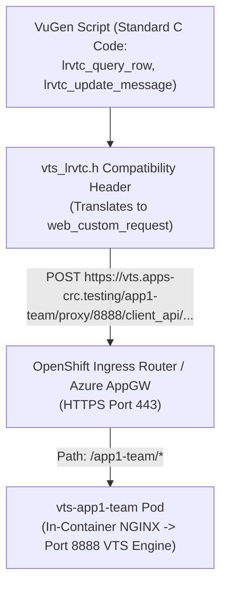

# OpenText Virtual Table Server (VTS) 26.1: Path-Based VuGen Tester Guide

This guide is designed for **Performance Test Engineers**, **VuGen Scripters**, and **QA Automation Teams** interacting with containerized OpenText Virtual Table Server (VTS) 26.1 deployed on Red Hat OpenShift / CRC using **Path-Based Multi-Tenancy**:
- **App1 Team:** `https://vts.apps-crc.testing/app1-team/`
- **App2 Team:** `https://vts.apps-crc.testing/app2-team/`

---

## 1. What This Folder Contains

| File | Type | Description |
| :--- | :--- | :--- |
| [`vts_lrvtc.h`](file:///home/mahesh/vts_ocp/containerized_ubuntu_deployment_pathbasedRoute/vugen_handling_example/vts_lrvtc.h) | C Header | **MANDATORY drop-in compatibility header.** Translates native `lrvtc_*` calls into HTTPS REST requests (`web_custom_request`) routed over the team's path prefix (`/app1-team/proxy/:port/client_api/...`) on standard port 443. |
| [`single_script_example.c`](file:///home/mahesh/vts_ocp/containerized_ubuntu_deployment_pathbasedRoute/vugen_handling_example/single_script_example.c) | C Source | **Complete, unified single-file LoadRunner script** combining `vuser_init`, `Action`, and `vuser_end`. |
| [`TESTERS_GUIDE.md`](file:///home/mahesh/vts_ocp/containerized_ubuntu_deployment_pathbasedRoute/vugen_handling_example/TESTERS_GUIDE.md) | Markdown | This step-by-step implementation, execution, and troubleshooting manual. |

---

## 2. Why the Custom Header (`vts_lrvtc.h`) is the ONLY Working Option for Path-Based Routing

In Path-Based Multi-Tenancy, all teams share a single domain (`vts.apps-crc.testing`) and are partitioned exclusively by URL sub-paths (`/app1-team`, `/app2-team`). 

The custom header [`vts_lrvtc.h`](file:///home/mahesh/vts_ocp/containerized_ubuntu_deployment_pathbasedRoute/vugen_handling_example/vts_lrvtc.h) is **mandatory** because the alternative methods (VuGen Runtime Setting Query String and native `lrvtc_connect_ex`) **fundamentally cannot work** in path-based architectures.

### Detailed Technical Proof: Why Runtime Settings Query String & `lrvtc_connect_ex` Fail

When attempting to connect natively using `lrvtc_connect_ex` or Runtime Settings query string:

```c
// THIS FAILS IN PATH-BASED ROUTING:
rc = lrvtc_connect_ex(
    "Server=https://vts.apps-crc.testing/app1-team",
    "Port=8888",
    "UserName=vtsadmin",
    "Password=*****",
    LAST);
```

VuGen immediately aborts with:
```text
vuser_init.c(24): Error: lrvtc_connect_ex: Cannot parse server response.
Abort was called from an action.
```

#### The Three Technical Root Causes:
1. **Socket Resolver / DNS Rejection of Sub-Paths:**
   - In VuGen's built-in `vtc.dll`, the `Server=` parameter is passed directly to the operating system's socket resolver (`getaddrinfo`).
   - Sockets only understand hostnames or IP addresses (e.g. `vts.apps-crc.testing`). When given `vts.apps-crc.testing/app1-team`, hostname resolution fails because `/app1-team` is an illegal character sequence in a DNS hostname.
2. **Native `vtc.dll` Always Targets Root (`/`):**
   - If the tester passes only the bare domain `https://vts.apps-crc.testing`, `vtc.dll` connects to port 443 and transmits an HTTP query-string request strictly against the root URI:
     ```http
     POST /?portnumber=8888 HTTP/1.1
     Host: vts.apps-crc.testing
     ```
   - VuGen's native C engine has **no capability** to prepend a sub-path prefix (`/app1-team/`) to its internal socket requests.
3. **OpenShift Ingress 503 Rejection:**
   - In Path-Based routing, OpenShift Ingress Router (HAProxy) matches routes strictly by path prefix:
     - `vts.apps-crc.testing/app1-team` $\rightarrow$ `vts-app1-team-service`
     - `vts.apps-crc.testing/app2-team` $\rightarrow$ `vts-app2-team-service`
   - When native VuGen requests `https://vts.apps-crc.testing/` (without `/app1-team`), OpenShift Ingress finds **no route configured for root `/`** and responds with:
     ```http
     HTTP/1.1 503 Service Unavailable
     Content-Type: text/html
     (No route found for host vts.apps-crc.testing at path /)
     ```
   - VuGen receives the HTML 503 page, fails to parse it as a valid VTS binary/JSON payload, and throws `Cannot parse server response`.

---

## 3. How the Compatibility Header (`vts_lrvtc.h`) Solves This

[`vts_lrvtc.h`](file:///home/mahesh/vts_ocp/containerized_ubuntu_deployment_pathbasedRoute/vugen_handling_example/vts_lrvtc.h) bypasses `vtc.dll`'s socket limitations by intercepting `lrvtc_*` calls using C preprocessor macros and routing them through LoadRunner's native Web Turbo Replay engine (`web_custom_request`):



1. **Path-Aware Routing:** Explicitly targets `https://vts.apps-crc.testing/app1-team/proxy/8888/client_api/...`, perfectly satisfying OpenShift Ingress path matching.
2. **Server-Side TLS & Auth:** Automatically injects TLS 1.2/1.3 options and the required Basic Authentication header (`Authorization: Basic ...`).
3. **Zero Script Changes:** Test logic in `Action.c` remains **100% standard LoadRunner C code**.

---

## 4. Step-by-Step Setup Guide

### Step 1: Configure Hosts File on Testing Workstation
Ensure your testing machine resolves `vts.apps-crc.testing`:
* **On Windows (`C:\Windows\System32\drivers\etc\hosts` as Administrator):**
  ```text
  127.0.0.1 vts.apps-crc.testing
  ```
*(Replace `127.0.0.1` with your actual OpenShift Ingress Router IP in distributed environments).*

---

### Step 2: Verify in Web Browser
Navigate to:
```text
https://vts.apps-crc.testing/app1-team/
```
1. Accept the self-signed TLS prompt.
2. Enter credentials: `vtsadmin` / `*****`.
3. Confirm the VTS Admin Console displays the table data.

---

### Step 3: Add `vts_lrvtc.h` to Your Script
1. Copy [`vts_lrvtc.h`](file:///home/mahesh/vts_ocp/containerized_ubuntu_deployment_pathbasedRoute/vugen_handling_example/vts_lrvtc.h) into the root folder of your VuGen script (alongside `default.cfg` and `globals.h`).
2. In `globals.h`, add:
   ```c
   #include "vts_lrvtc.h"
   ```

---

## 5. Complete Working VuGen Test Script

Place this code in `single_script_example.c` or distribute across `vuser_init.c`, `Action.c`, and `vuser_end.c`:

```c
#include "lrun.h"
#include "web_api.h"
#include "lrw_custom_body.h"
#include "vts_lrvtc.h"

// ==============================================================================
// 1. vuser_init: Connect via Path-Based Ingress
// ==============================================================================
int vuser_init()
{
    int rc;

    lr_output_message("[VTS] Connecting to https://vts.apps-crc.testing/app1-team (Port 8888)...");

    // Syntax: lrvtc_connect("<domain>/<team-subpath>", port, options)
    rc = lrvtc_connect("vts.apps-crc.testing/app1-team", 8888, 0);

    /*
     * For secondary multi-instance table (e.g. Instance_1 on Port 2000):
     * rc = lrvtc_connect("vts.apps-crc.testing/app1-team", 2000, 0);
     *
     * For App 2 Team:
     * rc = lrvtc_connect("vts.apps-crc.testing/app2-team", 8888, 0);
     */

    if (rc != 0) {
        lr_error_message(">>> [FATAL] Failed to connect to VTS app1-team pod! Return code: %d", rc);
        return -1;
    }

    lr_output_message(">>> [SUCCESS] Connected cleanly to VTS app1-team pod!");
    return 0;
}

// ==============================================================================
// 2. Action: Test Data Retrieval, Parameterization, and Live Updates
// ==============================================================================
int Action()
{
    static int current_iteration = 1;

    // -------------------------------------------------------------------------
    // Transaction 1: Fetch Row Data from VTS
    // -------------------------------------------------------------------------
    lr_start_transaction("VTS_01_Query_Customer_Data");

    // lrvtc_query_row fetches row at current_iteration and registers column parameters
    lrvtc_query_row(current_iteration);

    lr_output_message(">>> [ROW %d] Customer Code : %s", current_iteration, lr_eval_string("{Customer_Code}"));
    lr_output_message(">>> [ROW %d] Account Num   : %s", current_iteration, lr_eval_string("{Account_Num}"));
    lr_output_message(">>> [ROW %d] Region        : %s", current_iteration, lr_eval_string("{Region}"));
    lr_output_message(">>> [ROW %d] Current Status: %s", current_iteration, lr_eval_string("{Status}"));

    lr_end_transaction("VTS_01_Query_Customer_Data", LR_AUTO);

    lr_think_time(1);

    // -------------------------------------------------------------------------
    // Transaction 2: Update Status in VTS
    // -------------------------------------------------------------------------
    lr_start_transaction("VTS_02_Update_Status");

    // lrvtc_update_message updates the Status column on row current_iteration
    lrvtc_update_message("Status", current_iteration, "PROCESSED_VIA_PATH_BASED_WRAPPER");

    lr_output_message(">>> [ROW %d] Updated Status to 'PROCESSED_VIA_PATH_BASED_WRAPPER'", current_iteration);

    lr_end_transaction("VTS_02_Update_Status", LR_AUTO);

    current_iteration++;
    return 0;
}

// ==============================================================================
// 3. vuser_end: Clean Disconnect
// ==============================================================================
int vuser_end()
{
    lrvtc_disconnect();
    lr_output_message(">>> [VTS] Session disconnected cleanly.");
    return 0;
}
```

---

## 6. Execution Verification Output

When replaying the script (`F5`), the output log confirms successful REST communication over HTTPS 443:

```text
vts_lrvtc.h(37): [VTS] Connecting to https://vts.apps-crc.testing/app1-team (Instance Port 8888)...
vts_lrvtc.h(54): web_custom_request("VTS_Connect_Init") was successful, 111 body bytes
vts_lrvtc.h(67): [VTS] Connected successfully! Discovered 10 columns.
vuser_init.c(7): >>> [SUCCESS] Connected cleanly to VTS app1-team pod!
Action.c(6): Notify: Transaction "VTS_01_Query_Customer_Data" started.
vts_lrvtc.h(106): web_custom_request("VTS_QueryRow") was successful
Action.c(12): >>> [ROW 1] Customer Code : IND_Cust_1
Action.c(13): >>> [ROW 1] Account Num   : IND_ACC_10001
Action.c(14): >>> [ROW 1] Current Status: ACTIVE
Action.c(16): Notify: Transaction "VTS_01_Query_Customer_Data" ended with a "Pass" status (Duration: 0.1713)
Action.c(19): Notify: Transaction "VTS_02_Update_Status" started.
vts_lrvtc.h(160): web_custom_request("VTS_UpdateMessage") was successful
Action.c(24): >>> [ROW 1] Updated Status to 'PROCESSED_VIA_PATH_BASED_WRAPPER'
Action.c(26): Notify: Transaction "VTS_02_Update_Status" ended with a "Pass" status (Duration: 0.0784)
vts_lrvtc.h(249): [VTS] Disconnected cleanly.
Vuser Terminated.
```

---

## 7. Troubleshooting & Common Pitfalls

### Issue 1: "One or more files in scripts folder are in use preventing script to replay"
* **Probable Cause A (Background Process):** A previous failed or aborted run left `mmdrv.exe` or `cci.exe` active in the background.
  * **Fix:** Open Windows Task Manager (`Ctrl + Shift + Esc`) -> **Details** tab -> Locate `mmdrv.exe` or `cci.exe` -> Click **End Task**. In VuGen, click **Design** -> **Clean Script**.
* **Probable Cause B (Microsoft OneDrive File Lock):** If the script is stored inside `OneDrive\Documents\...`, OneDrive's real-time cloud synchronizer immediately locks newly created files (`pre_cci.ci`, `mdrv.log`), blocking VuGen's compiler.
  * **Fix:** Right-click the OneDrive icon in the Windows taskbar -> **Pause syncing (2 hours)**, or move the script folder out of OneDrive to a local directory (e.g., `C:\VuGen\Scripts\VTS_PATH_Based_Validation`).

---

### Issue 2: `Action.c: Unresolved symbol : lr_get_iteration`
* **Probable Cause:** `lr_get_iteration()` is an internal Controller/Analysis function and does **not** exist in the VuGen Web (HTTP/HTML) C protocol runtime library.
* **Fix:** Do not use `lr_get_iteration()`. Use a C `static int` counter as shown in the script:
  ```c
  static int current_iteration = 1;
  // ... at the end of Action:
  current_iteration++;
  ```

---

### Issue 3: `globals.h: error: vts_lrvtc.h no such file or directory`
* **Probable Cause:** The file was saved inside a subfolder, or Windows saved it as `vts_lrvtc.h.txt`.
* **Fix:** Ensure the file is named exactly `vts_lrvtc.h` and is located in the root script directory right alongside `globals.h` and `default.cfg`.

---

### Issue 4: `redeclaration of 'lrvtc_disconnect' previously declared at ... SharedParameter.h`
* **Probable Cause:** LoadRunner's built-in header declares function prototypes with conflicting signatures.
* **Fix:** Handled transparently inside [`vts_lrvtc.h`](file:///home/mahesh/vts_ocp/containerized_ubuntu_deployment_pathbasedRoute/vugen_handling_example/vts_lrvtc.h) by implementing internal routines as `vts_wrap_*` and remapping them with preprocessor macros (`#define lrvtc_... vts_wrap_...`).

---

### Issue 5: `Warning -27077: The 'vuser_init' section contains web function(s) when 'Simulate a new user on each iteration' is ON`
* **Probable Cause:** VuGen alerts that HTTP calls in `vuser_init` may not reset between iterations when new user simulation is enabled.
* **Explanation:** This warning is expected and harmless. VTS connection is established once during initialization in `vuser_init` and reused throughout all iterations.

---

## 8. Direct cURL Command Examples (Live API Reference)

For quick health checks or data preparation scripts without launching VuGen:

### 8.1 Fetch Schema (`getAllColumns`)
```bash
curl -k -s -u vtsadmin:***** \
  -H "Content-Type: application/json" \
  -d '{}' \
  "https://vts.apps-crc.testing/app1-team/proxy/8888/client_api/getAllColumns"
```
**Response:**
```json
["ID","Customer_Code","Account_Num","Region","Status","Txn_Amount","Batch_ID","Category","Priority","Comments"]
```

### 8.2 Fetch Row Slice (`getTable`)
```bash
curl -k -s -u vtsadmin:***** \
  -H "Content-Type: application/json" \
  -d '{"start":1,"end":1}' \
  "https://vts.apps-crc.testing/app1-team/proxy/8888/client_api/getTable"
```
**Response:**
```json
[["1","IND_Cust_1","IND_ACC_10001","APAC","ACTIVE","11.50","IND_BATCH_B","ENTERPRISE","NORMAL","IND_Record_1"]]
```

### 8.3 Update Cell Value (`update`)
```bash
curl -k -s -u vtsadmin:***** \
  -H "Content-Type: application/json" \
  -d '{"index":1,"column":"Status","value":"PROCESSED_BY_WINDOWS_VUGEN"}' \
  "https://vts.apps-crc.testing/app1-team/proxy/8888/client_api/update"
```
**Response:** `null` (HTTP 200 OK)

### 8.4 Retrieve Record in FIFO Order (`retrieve`)
```bash
curl -k -s -u vtsadmin:***** \
  -H "Content-Type: application/json" \
  -d '{"columns":["Batch_ID"],"condition":0}' \
  "https://vts.apps-crc.testing/app1-team/proxy/8888/client_api/retrieve"
```

### 8.5 Add New Record to Bottom of Table (`add`)
```bash
curl -k -s -u vtsadmin:***** \
  -H "Content-Type: application/json" \
  -d '{"option":0,"new":{"Customer_Code":"NEW_CUST_99","Status":"PENDING"}}' \
  "https://vts.apps-crc.testing/app1-team/proxy/8888/client_api/add"
```

### 8.6 Clear Column Data (`clearColumn`)
```bash
curl -k -s -u vtsadmin:***** \
  -H "Content-Type: application/json" \
  -d '{"start":1,"columns":["Comments"]}' \
  "https://vts.apps-crc.testing/app1-team/proxy/8888/client_api/clearColumn"
```
