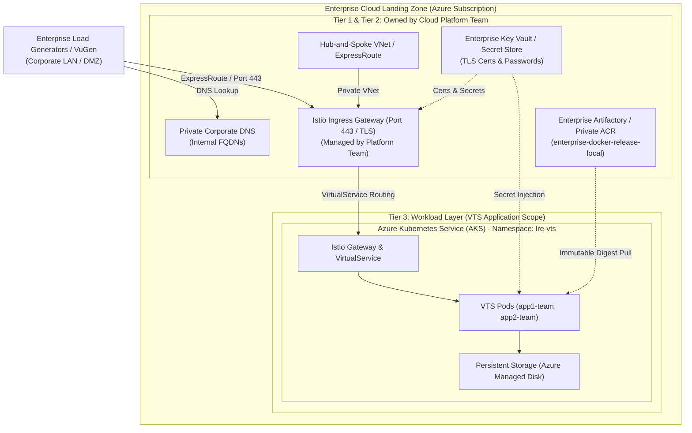
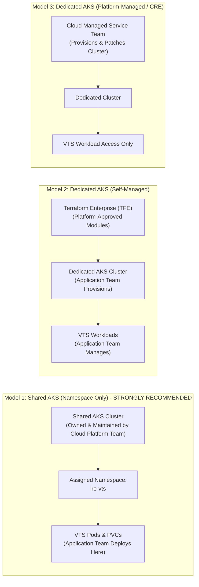
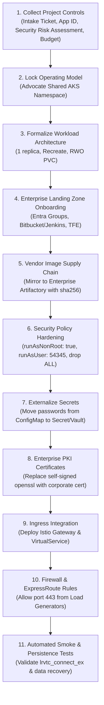
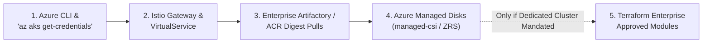
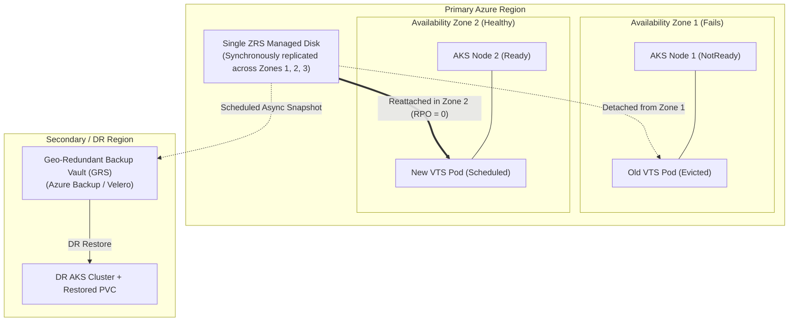

# OpenText VTS: Azure Kubernetes Service (AKS) & Enterprise Landing Zone (ELZ) Playbook

This reference manual is tailored for performance test leads, application owners, and engineers transitioning OpenText Virtual Table Server (VTS) 26.1 from local containerized environments (OpenShift / CRC) to an **Enterprise Cloud Landing Zone on Microsoft Azure (AKS)**.

---

## 1. Executive Summary: POC Validation

> [!IMPORTANT]
> **OpenShift is Kubernetes. AKS is Kubernetes.**
> Over the course of testing on OpenShift Local (CRC), the POC successfully validated the foundational architecture:
> - **Workload Isolation:** Two independent single-instance VTS workloads (`vts-app1-team` and `vts-app2-team`), each with its own pod, configuration, and dedicated persistent storage.
> - **Stateful Persistence:** `Recreate` deployment strategy with 1 replica and dedicated RWO persistent volume claims (`/var/lib/OT/OT_VTS/db/data`) preventing multi-attach corruption.
> - **In-Container Reverse Proxy & SSRF Protection:** In-container NGINX listening on port `8443`, proxying admin UI (port 4000) and dynamically routing instance API requests (`?portnumber=2000..2050`) while blocking direct external access to raw database sockets.
> - **Non-Root Execution Profile:** Processes designed for non-root execution (`vts_user` UID/GID `54345`).
> - **LoadRunner Client Compatibility:** Verified sub-200ms latency using LoadRunner VuGen `lrvtc_connect_ex` over standard HTTPS port 443.
>
> The core workload engine is **production-viable**. Transitioning to Azure AKS requires addressing **external enterprise governance, landing zone ingress (e.g. Istio), security policies, and image supply chain standards**.

---

## 2. Enterprise Cloud Ecosystem & Terminology Demystified



### Key Enterprise Concepts:

| Term | What It Means | Impact on VTS |
| :--- | :--- | :--- |
| **Cloud Intake Portal** | The internal enterprise intake portal where teams initiate cloud hosting requests, budget reviews, and architecture reviews. | Initiates the onboarding assessment to determine hosting model and cloud costs. |
| **ELZ (Enterprise Landing Zone)** | A pre-architected, security-hardened Azure subscription foundation enforcing corporate guardrails, network routing, firewalls, and compliance policies. | VTS will deploy inside this landing zone; direct public internet ingress is blocked; all traffic routes via corporate ExpressRoute. |
| **Cloud Platform Team** | The central platform engineering group managing cloud operations, landing zones, and foundational infrastructure. | Reviews the Cloud Intake request and determines whether VTS is onboarded to a shared namespace or a dedicated cluster. |
| **Tier 1 / Tier 2 vs. Tier 3** | **Tier 1 & 2:** Core infrastructure (networking, subscriptions, IAM, platform policies). Owned by Cloud Platform Team.<br>**Tier 3:** Application workloads (Pods, Namespaces, Storage claims). Owned by application/DevOps teams. | The application team owns the VTS layer (Tier 3) without managing enterprise networks or ExpressRoute firewalls. |
| **Istio Ingress Gateway** | Enterprise service mesh ingress controller managing inbound HTTPS traffic, TLS termination, and L7 virtual routing. | Replaces the OpenShift `Route`. Ingress traffic is managed via Istio `Gateway` and `VirtualService` CRDs. |
| **Entra ID (Azure AD)** | Microsoft’s identity management platform. | Controls RBAC access for developers, pipeline service principals, and admin console access. |
| **Enterprise Artifactory / ACR** | Corporate private container registry (`enterprise-docker-release-local`). | The VTS Ubuntu image will be scanned (Xray/Defender) and pinned by immutable sha256 digest. |

---

## 3. The 3 Potential AKS Hosting Models

During the Cloud Intake / Architecture assessment, the platform team evaluates VTS against three models:



### Detailed Comparison:

| Dimension | Model 1: Shared AKS (Namespace) | Model 2: Dedicated AKS (Self-Managed) | Model 3: Dedicated AKS (Platform-Managed) |
| :--- | :--- | :--- | :--- |
| **Recommendation for VTS** | **Highest (Strongly Recommended)** | Low (Avoid unless forced) | Medium (Only if isolation mandates it) |
| **Provisioned Resources** | A pre-configured namespace (`lre-vts`) with RBAC access. | An empty Azure resource group + approved Terraform modules. | A ready dedicated cluster operated by a cloud managed service. |
| **Team Ownership** | Only Kubernetes YAMLs (`kubectl apply`) + VTS application. | Terraform code to build cluster + node pool maintenance + VTS YAMLs. | Only Kubernetes YAMLs + VTS application. |
| **Operational Overhead** | **Low** (Same workflow as OpenShift container operations). | **Moderate-High** (Requires Terraform + Azure CLI). | **Low-Moderate**. |
| **Cluster Upgrades** | Handled 100% by central platform team. | Application team plans and executes node upgrades. | Handled by platform managed service. |
| **FinOps Cost** | Lowest compute cost (fraction of shared node pool). | High cost (dedicated control plane, minimum 3 VM nodes). | High cost (dedicated VMs + managed operations fee). |

---

## 4. 1-to-1 Translation: OpenShift (CRC) to Azure AKS

| Architecture Layer | OpenShift Local (CRC POC) | Azure Kubernetes Service (AKS Equivalent) | Changes Needed in Manifests |
| :--- | :--- | :--- | :--- |
| **CLI Tool** | `oc` | `kubectl` (after running `az aks get-credentials`) | Commands are 100% identical (`kubectl get pods`, `kubectl apply`). |
| **Routing / Ingress** | OpenShift `Route` (`reencrypt` on port 443) | **Istio Ingress Gateway** (`Gateway` + `VirtualService`) or AGIC | Replace `vts-route.yaml` with Istio `Gateway` and `VirtualService` manifests. |
| **StorageClass** | `crc-csi-hostpath-provisioner` (RWO) | `managed-csi` (Azure Premium SSD Disk) | Change `storageClassName` in `vts-pvc.yaml` from local hostpath to `managed-csi`. |
| **Workload Specification** | `vts-deployment.yaml` (`Deployment`) | `vts-deployment.yaml` (`Deployment`) | Sizing, digest pinning, and hardened security context. |
| **Configuration & NGINX** | `vts-configmap.yaml` (`ConfigMap`) | `ConfigMap` (Config) + `Secret` (Credentials) | Separate passwords into a Kubernetes Secret. |
| **Non-Root Execution** | `securityContext: fsGroup: 54345` | `securityContext: runAsNonRoot: true`, `runAsUser: 54345`, `runAsGroup: 54345`, `allowPrivilegeEscalation: false` | Enforce explicit container security context to comply with Azure Policy Restricted Profile. |
| **Image Source** | `performancetesting/opentext_vts_linux_ubuntu:26.1` | `<corp-artifactory>/vts/opentext_vts_linux_ubuntu@sha256:<digest>` | Pin image to enterprise repository with immutable sha256 digest. |
| **Certificates** | Self-signed generated via inline openssl script | Corporate PKI certificate mounted via Kubernetes TLS Secret | Mount enterprise certificate read-only or terminate at Istio Ingress Gateway. |

---

## 5. Production-Grade AKS Manifest Templates (Component-Wise)

All Kubernetes resources are split into clean, component-wise YAML files in this directory.

### Apply Order & Component Inventory

| Order | App1 File | App2 File | Resource | Key AKS / Enterprise Notes |
| :---: | :--- | :--- | :--- | :--- |
| **1** | `vts-namespace-aks.yaml` | *(shared `lre-vts`)* | `Namespace` | Creates `lre-vts` (omit if Cloud Platform Team pre-provisions namespace). |
| **2** | `vts-pvc-aks.yaml` | `vts-app2-pvc-aks.yaml` | `PersistentVolumeClaim` | Uses `managed-csi` (switch to approved ZRS StorageClass once Multi-AZ ZRS is available). |
| **3** | `vts-secret-aks.yaml` | `vts-app2-secret-aks.yaml` | `Secret` | Stores VTS `vtsadmin` & `tester` credentials outside ConfigMaps (or sync from Key Vault CSI). |
| **4** | `vts-configmap-aks.yaml` | `vts-app2-configmap-aks.yaml` | `ConfigMap` | `configure.json` template + CVE-remediated `vts-nginx.conf` (`listen 8443 ssl;`). |
| **5** | `vts-deployment-aks.yaml` | `vts-app2-deployment-aks.yaml` | `Deployment` | Hardened `securityContext` (`UID/GID 54345`, `runAsNonRoot: true`, `drop: [ALL]`) + `tcpSocket` probes. |
| **6** | `vts-service-aks.yaml` | `vts-app2-service-aks.yaml` | `Service` | `ClusterIP` mapping port `443` → container port `8443`. |
| **7** | `vts-istio-ingress.yaml` | `vts-app2-istio-ingress.yaml` | `Gateway` + `VirtualService` | Istio Ingress routing on port `443` with corporate TLS secret (`vts-app1.*` / `vts-app2.*`). |

> [!NOTE]
> **Live AKS (`v1.36.5`) Validation Findings:**
> - **Hardened `securityContext`:** Verified working with `runAsNonRoot: true`, `runAsUser: 54345`, `runAsGroup: 54345`, `allowPrivilegeEscalation: false`, `capabilities: drop: [ALL]`, and `seccompProfile: RuntimeDefault`.
> - **Health Probes (`401` Discovery):** VTS Basic Auth returns `HTTP 401` on `/`, causing Kubernetes `httpGet` probes to fail. **`tcpSocket` on port `8443`** was validated and passes cleanly.
> - **Storage:** `managed-csi` binds cleanly under `Recreate` deployment strategy. Multi-AZ ZRS (`managed-csi-zrs`) requires a fresh PVC when enabled by the Cloud Platform Team.

### 5.1 AKS Persistent Volume Claim (`vts-pvc-aks.yaml`)
```yaml
apiVersion: v1
kind: PersistentVolumeClaim
metadata:
  name: vts-app1-data-pvc
  namespace: lre-vts
  labels:
    app: vts-app1-team
spec:
  accessModes:
    - ReadWriteOnce
  storageClassName: managed-csi # Azure Premium SSD CSI driver for high-IOPS Valkey dumps
  resources:
    requests:
      storage: 30Gi
```

### 5.2 Kubernetes Secret for VTS Credentials (`vts-secret-aks.yaml`)
```yaml
apiVersion: v1
kind: Secret
metadata:
  name: vts-app1-credentials
  namespace: lre-vts
type: Opaque
stringData:
  # Administrator role: full VTS UI & instance management
  admin_user: "vtsadmin"
  admin_password: "*****"
  # User role (read-only / test operator)
  readonly_user: "tester"
  readonly_password: "*****"
```

### 5.3 Istio Ingress Gateway Routing (`vts-istio-ingress.yaml`)

When the cloud platform team provides an **Istio Ingress Gateway**, traffic routing is controlled using standard Istio CRDs:

```yaml
# 1. Istio Gateway: Binds to the platform Istio Ingress Controller on Port 443
apiVersion: networking.istio.io/v1beta1
kind: Gateway
metadata:
  name: vts-app1-gateway
  namespace: lre-vts
spec:
  selector:
    # Matches the platform-managed Istio Ingress Gateway pod label
    istio: ingressgateway
  servers:
  - port:
      number: 443
      name: https
      protocol: HTTPS
    tls:
      mode: SIMPLE
      credentialName: vts-app1-enterprise-tls-cert # Secret containing corporate CA cert
    hosts:
    - "vts-app1.internal.cloud.corp"
---
# 2. Istio VirtualService: Routes traffic to the backend VTS Service
apiVersion: networking.istio.io/v1beta1
kind: VirtualService
metadata:
  name: vts-app1-virtualservice
  namespace: lre-vts
spec:
  hosts:
  - "vts-app1.internal.cloud.corp"
  gateways:
  - vts-app1-gateway
  http:
  - match:
    - uri:
        prefix: /
    route:
    - destination:
        host: vts-app1-team-service.lre-vts.svc.cluster.local
        port:
          number: 443 # Routes to in-container NGINX reverse-proxy
```

### 5.4 Hardened AKS Deployment (`vts-deployment-aks.yaml`)

This deployment strictly complies with **Azure Policy Restricted Profile** and the enterprise security standard:

```yaml
apiVersion: apps/v1
kind: Deployment
metadata:
  name: vts-app1-team
  namespace: lre-vts
  labels:
    app: vts-app1-team
spec:
  replicas: 1
  strategy:
    type: Recreate # Ensures RWO persistent volume detaches cleanly before reattaching
  selector:
    matchLabels:
      app: vts-app1-team
  template:
    metadata:
      labels:
        app: vts-app1-team
    spec:
      # Pod-level security context
      securityContext:
        runAsNonRoot: true
        runAsUser: 54345
        runAsGroup: 54345
        fsGroup: 54345
        seccompProfile:
          type: RuntimeDefault

      containers:
      - name: vts-server
        # Fully qualified enterprise registry with immutable sha256 digest
        image: artifactory.internal.cloud.corp/enterprise-docker-release-local/vts/opentext_vts_linux_ubuntu@sha256:e3b0c44298fc1c149afbf4c8996fb92427ae41e4649b934ca495991b7852b855
        imagePullPolicy: IfNotPresent
        workingDir: /opt/OT/OT_VTS/web
        
        # Container-level security context (Passes Gatekeeper / Azure Policy checks)
        securityContext:
          allowPrivilegeEscalation: false
          runAsNonRoot: true
          runAsUser: 54345
          runAsGroup: 54345
          capabilities:
            drop:
            - ALL

        env:
        - name: GIN_MODE
          value: "release"
        - name: VTS_ADMIN_PASSWORD
          valueFrom:
            secretKeyRef:
              name: vts-app1-credentials
              key: admin_password
        - name: VTS_READONLY_PASSWORD
          valueFrom:
            secretKeyRef:
              name: vts-app1-credentials
              key: readonly_password

        resources:
          requests:
            cpu: "500m"
            memory: "1Gi"
          limits:
            cpu: "2000m"
            memory: "4Gi"

        ports:
        - name: https-web
          containerPort: 8443

        # Use tcpSocket: 8443 because VTS Basic Auth returns HTTP 401 on /
        startupProbe:
          tcpSocket:
            port: 8443
          periodSeconds: 5
          failureThreshold: 24
        readinessProbe:
          tcpSocket:
            port: 8443
          periodSeconds: 10
          timeoutSeconds: 3
          failureThreshold: 3
        livenessProbe:
          tcpSocket:
            port: 8443
          periodSeconds: 20
          timeoutSeconds: 3
          failureThreshold: 3

        volumeMounts:
        # Mounted as template; startup script injects VTS_ADMIN_PASSWORD from Secret into /opt/OT/OT_VTS/web/configure.json
        - name: config-mount
          mountPath: /tmp/configure.json.tmpl
          subPath: configure.json
        - name: nginx-mount
          mountPath: /etc/nginx/nginx.conf
          subPath: vts-nginx.conf
        - name: vts-db-storage
          mountPath: /var/lib/OT/OT_VTS/db/data

      volumes:
      - name: config-mount
        configMap:
          name: vts-app1-config
          items:
          - key: configure.json
            path: configure.json
      - name: nginx-mount
        configMap:
          name: vts-app1-config
          items:
          - key: vts-nginx.conf
            path: vts-nginx.conf
      - name: vts-db-storage
        persistentVolumeClaim:
          claimName: vts-app1-data-pvc
```

---

## 6. Production Transition Roadmap (11-Step Checklist)

Checklist to transition VTS from the OpenShift POC to production Enterprise AKS:



| Step # | Action Item | Technical Execution |
| :--- | :--- | :--- |
| **Step 1** | **Project Controls** | Secure the Cloud Intake ticket number, and ensure the business case is submitted for Enterprise FinOps review. |
| **Step 2** | **Operating Model** | Request a shared namespace (`lre-vts`) to eliminate the burden of managing dedicated cluster infrastructure. |
| **Step 3** | **Workload Model** | Submit the architecture input: Single-instance stateful design, 1 replica, `Recreate` deployment strategy, RWO persistent storage. |
| **Step 4** | **ELZ Onboarding** | Complete Day 1 onboarding for `<app-id> / VTS / <env>` (Entra ID security groups, CI/CD pipeline service principals). |
| **Step 5** | **Vendor Image Mirroring** | Push the official OpenText image into `enterprise-docker-release-local` and reference it by immutable digest (`@sha256:...`). |
| **Step 6** | **Security Hardening** | Add `runAsNonRoot: true`, `runAsUser: 54345`, `runAsGroup: 54345`, `allowPrivilegeEscalation: false`, and `capabilities: drop: [ALL]`. |
| **Step 7** | **Secret Management** | Remove hardcoded passwords from `configure.json` / `ConfigMap`; inject via Kubernetes Secret or Azure Key Vault CSI provider. |
| **Step 8** | **Corporate PKI** | Replace container-generated self-signed certificates with enterprise-issued TLS certificates bound to corporate private DNS. |
| **Step 9** | **Istio Ingress Gateway** | Apply Istio `Gateway` and `VirtualService` CRDs matching the platform Istio ingress gateway labels. |
| **Step 10** | **Network & Firewall** | Submit firewall requests allowing TCP port 443 from enterprise Load Generators / VuGen workstations over ExpressRoute to the Ingress IP. |
| **Step 11** | **Validation & Recovery** | Execute automated smoke tests with VuGen `lrvtc_connect_ex` and test pod deletion to verify Valkey data persists across restarts. |

---

## 7. AKS & Azure Onboarding Reference

Key Azure and AKS operational concepts required beyond standard Kubernetes manifest management:



### Operational Reference:

#### 1. Azure CLI & Accessing AKS
- **Key Commands:**
  ```bash
  az login
  az account set --subscription "<Subscription-ID>"
  az aks get-credentials --resource-group "<RG-Name>" --name "<Cluster-Name>"
  kubectl get nodes
  kubectl get pods -n lre-vts
  ```
- Once `az aks get-credentials` is executed, daily cluster operations use standard `kubectl` commands.

#### 2. Istio Ingress Gateway & VirtualService
- The Istio Ingress Gateway terminates TLS on port 443 and forwards traffic to internal Kubernetes Services.
- `VirtualService` routes corporate hostnames (`vts-app1.internal.cloud.corp`) and path prefixes to backend Services.

#### 3. Enterprise Image Management & Digest Pinning
- Enterprise security mandates immutable image digests (`@sha256:...`) instead of floating tags (`:latest`, `:26.1`).

#### 4. Azure Storage Architecture
- **Azure Managed Disk (`managed-csi` / `managed-csi-zrs`):** Best for single-pod stateful workloads like VTS where high IOPS and low-latency disk writes for Valkey RDB snapshots (`save 60 1`) are critical.
- **Azure Files (`azurefile-csi`):** Supports `ReadWriteMany` (RWX) if multiple pods ever need shared access.

#### 5. Terraform on Azure (Only if Model 2 is chosen)
- If a dedicated subscription/cluster is provisioned via Terraform Enterprise:
  - Consume the **pre-approved corporate Terraform modules** from the platform team by passing input variables (VNet ID, Subnet ID, Cluster Name) rather than authoring raw infrastructure modules.

---

## 8. Key Architecture & Platform Alignment Questions

Open items to confirm with the Enterprise Architecture and Cloud Platform teams during onboarding:

### Question 1: Hosting Model & Cluster Ownership
> *"In the Cloud Intake assessment for VTS, are we being onboarded to an existing shared AKS cluster (Namespace-as-a-Service for VTS), or is architecture mandating a dedicated AKS cluster for VTS due to stateful disk and network isolation requirements?"*

### Question 2: Istio Ingress Gateway Integration
> *"Since the platform team utilizes Istio Ingress Gateway, will our namespace receive an approved Istio `Gateway` resource, or should we define a namespace-scoped `VirtualService` binding to the central `istio-system/ingressgateway`?"*

### Question 3: StorageClass & IOPS
> *"Which CSI StorageClass is approved for stateful workloads in our Landing Zone (`managed-csi` Premium SSD or `azurefile-csi`)? VTS requires persistent local volume attachments for real-time Valkey snapshots."*

### Question 4: Container Registry & Image Vulnerability Scanning
> *"What is the approved procedure to mirror the vendor VTS base image into our enterprise Artifactory repository (`enterprise-docker-release-local`), and what vulnerability scanning gate (Xray, Prisma, Defender) must it clear before deployment?"*

### Question 5: DNS & ExpressRoute Connectivity
> *"Will the VTS Ingress Gateway IP be mapped to a Private Corporate DNS entry (e.g., `vts-app1.internal.cloud.corp`) reachable over our corporate ExpressRoute connection from on-premises Load Generators and tester workstations?"*

---

## 9. Multi-AZ High Availability (ZRS) vs. Regional Disaster Recovery (DR)

Because VTS is a stateful, single-replica (`replicas: 1`, `strategy: Recreate`) workload using a `ReadWriteOnce` PVC, **High Availability (Multi-AZ)** and **Disaster Recovery (Multi-Region)** operate at two distinct layers:



### Key Architectural Rules:
1. **Node Distribution (1 Node Per Zone):**
   - For a Dedicated AKS cluster to survive a zone failure, at least **1 node per Availability Zone** is required (typically **3 nodes across Zones 1, 2, and 3**).
   - On a Shared AKS platform, the Cloud Platform Team already maintains multi-zone node pools across Zones 1, 2, and 3.
2. **StorageClass (`LRS` vs. `ZRS`):**
   - Standard `managed-csi` (**LRS**) pins the disk to a single Availability Zone. If that zone fails, the pod cannot attach the disk in another zone.
   - Multi-AZ failover requires a **ZRS StorageClass** (e.g., `managed-csi-zrs`), which synchronously replicates writes across 3 zones (`RPO = 0`).
   - *Note:* Kubernetes does not allow changing `storageClassName` on an existing bound PVC in-place; migrating from `LRS` to `ZRS` requires creating fresh ZRS PVCs.
3. **Regional DR:**
   - ZRS does **not** replicate across Azure regions. Regional disaster recovery or table corruption recovery relies on scheduled **Azure Backup for AKS / Velero** snapshots stored in a **Geo-Redundant (GRS)** vault in the paired DR region.

| Failure Scenario | Protection Mechanism | Data Loss (RPO) | Recovery |
| :--- | :--- | :--- | :--- |
| **Pod crash / node reboot** | `Recreate` + `managed-csi` PVC | **0** (data on disk) | Automatic (~30–60s) |
| **1 Availability Zone outage** | **Multi-AZ ZRS StorageClass** (`managed-csi-zrs`) + 1 node/zone | **0** (synchronous 3-zone copy) | Automatic (~2–5 mins) |
| **Full Azure Region outage / DB corruption** | **Scheduled PVC Backups** (Azure Backup / Velero → GRS) | Snapshot interval (e.g., 1h / 24h) | Restore PVC from snapshot |

---

## 10. Sandbox Repro & Live Validation Record

All core workload mechanics were validated live on **Azure AKS (`v1.36.5`, `Standard_D2s_v3`, `managed-csi`)**:
- **Pod Security:** `runAsNonRoot: true`, `runAsUser: 54345`, `runAsGroup: 54345`, `allowPrivilegeEscalation: false`, `capabilities: drop: [ALL]`, and `seccompProfile: RuntimeDefault` passed cleanly.
- **Health Probes:** Discovered VTS Basic Auth returns `HTTP 401` on `/` (failing `httpGet` probes); validated `tcpSocket` on port `8443` for `startupProbe`, `readinessProbe`, and `livenessProbe`.
- **Persistence:** Deleted and recreated the running VTS pod; verified `managed-csi` Azure Disk reattached and preserved both VTS table data and the `2000` port instance in `instances.json`.
- **Repro Script:** Complete standalone commands for spinning up and validating in a fresh AKS sandbox are saved in [`kodekloud_aks_repro_commands.txt`](kodekloud_aks_repro_commands.txt).

---

## 11. TLS Certificates & AES Encryption Standard

| Environment | Certificate Source | How It Is Provided |
| :--- | :--- | :--- |
| **Sandbox (`kodekloud_aks_repro_commands.txt`)** | Self-signed (`openssl`) | Container startup script generates `/opt/OT/OT_VTS/web/vts.crt` and `vts.key` on boot (`/CN=vts-app1.aks.test`). |
| **Enterprise AKS (Production)** | **Enterprise PKI / Corporate CA** | **Remove** `openssl` self-signed generation. Issue CA-signed certificate for the corporate FQDN and sync via Azure Key Vault / `cert-manager` into Kubernetes TLS Secrets. |

### Recommended Certificate & Encryption Profile
- **Certificate Format & Type:** `kubernetes.io/tls` Secret (`X.509` PEM `tls.crt` and `tls.key`, **RSA-2048/4096** or **ECDSA P-256**).
- **TLS Protocols:** **TLS 1.2** and **TLS 1.3** only (TLS 1.0/1.1 disabled).
- **AES Encryption Ciphers:** **AES-256-GCM** and **AES-128-GCM** (`ECDHE-ECDSA-AES256-GCM-SHA384`, `ECDHE-RSA-AES256-GCM-SHA384`, `ECDHE-ECDSA-AES128-GCM-SHA256`, `ECDHE-RSA-AES128-GCM-SHA256`).
- **Two Placement Points:**
  1. **Istio Ingress Gateway (`vts-istio-ingress.yaml`):** `credentialName: vts-app1-enterprise-tls-cert` (external TLS facing Load Generators & browsers).
  2. **Backend VTS NGINX (`vts-deployment-aks.yaml` & `vts-configmap-aks.yaml`):** Mounted read-only from `vts-app1-tls-cert` at `/opt/OT/OT_VTS/web/certs/tls.crt` & `tls.key` (when TLS re-encryption to port `8443` is enabled).

```bash
# Example: Create Kubernetes TLS Secret from Enterprise CA-signed cert & key
kubectl create secret tls vts-app1-tls-cert -n lre-vts \
  --cert=vts-app1.crt \
  --key=vts-app1.key
```

